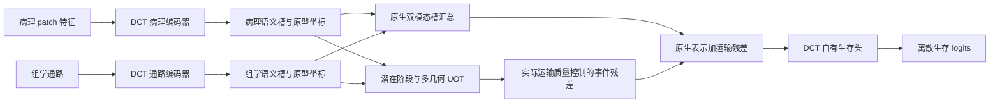

# 独立 DCT v2：六项生存训练目标

更新时间：2026-10-13。用户已明确要求独立主模型，方法入口是 `dct_v2`，别名 `dct_v2_standalone`。本版本使用 DCT 自身的病理与组学编码、语义槽、运输表示和生存预测头。此前的 `transport_plugin_v2` 是另一个保留的实现，不作为此处主模型的训练入口。

当前研究问题仍是：只有患者级病理—组学配对、没有局部对应标注时，如何学习服务生存预测的跨模态证据匹配，并允许部分信息不参与跨模态交换。独立主模型验证这一机制；外部骨干插件的实用性验证属于另一项实验。

## 网络与输出



两种模态使用各自的跨患者共享原型库。默认 BLCA UNI2-h 配置有 8 个病理槽、8 个组学槽、4 个潜在计算阶段和 3 种几何成本。潜在阶段不直接代表临床分期或生存时间分箱。每个阶段读取一条事件查询；查询数由阶段数决定。

UOT 放松行、列质量约束，让不合适的信息减少交换。实际运输的总质量和局部质量缺额控制残差，原生槽汇总仍直接进入预测路径。有限成本下的 UOT 是软质量放松，不自动形成严格的零匹配，也不证明保留下来的槽具有独立的生物学私有语义。

`DCTV2.forward(**kwargs)` 返回 `(logits[B, C], auxiliary_loss)`。这里输出的是未经过 sigmoid 的 logits；共享训练器的损失和风险计算对它执行一次 sigmoid。推理时只计算主预测，五项辅助损失不会参与推理。

## 总损失

\[
L_{\mathrm{total}} = L_{\mathrm{surv}}
+ 0.10 L_{\mathrm{IPCW-rank}}
+ 0.05 L_{\mathrm{per-slot-NLL}}
+ 0.10 L_{\mathrm{slot-diversity}}
+ 0.05 r_{\mathrm{rel}}(e) L_{\mathrm{relation}}
+ 0.05 L_{\mathrm{native}}.
\]

当前配方只有这六项，不创建重构解码器。各系数是可消融的初始工程设置，尚未经过真实患者实验优化。主 NLL 在共享训练器按批次求和，再除以真实批量一次；模型返回的五项辅助损失使用批次均值，避免重复计入主 NLL。

| 项 | 定义与作用 | 参数 |
|---|---|---|
| 主生存 NLL | DCT 自有生存头的稳定离散时间似然 | `bag_loss=nll_surv`, `alpha_surv=0` |
| IPCW rank | 用训练折删失分布校正可比较患者的风险排序 | `dct_v2_lambda_ipcw_rank=0.10` |
| per-slot NLL | 病理和组学的每个槽分别接受生存监督 | `dct_v2_lambda_slot_nll=0.05` |
| slot diversity | 对两种模态各自的原始槽加入方差范围与槽间距离约束 | `dct_v2_lambda_diversity=0.10` |
| relation | 固定实际行列边际与总运输量后，学习匹配的生存 NLL 若高于独立耦合，惩罚该差值 | `dct_v2_lambda_relation=0.05` |
| native | 根据参考质量缺额加权，监督 DCT 自身未经运输的原生表示 | `dct_v2_lambda_native=0.05` |

关系损失使用同一个冻结的 DCT 读取路径与生存头，比较固定实际边际下的学习计划和独立耦合。边际、总质量、槽、读取权重与质量门控均停止梯度，辅助梯度只训练匹配成本。因此它比较的是匹配关系，不能通过简单减少交换量降低这一辅助目标。独立耦合保持实际行列边际和总质量。

\[
L_{\mathrm{relation}} = \max\left(0,
L_{\mathrm{NLL}}(T_{\mathrm{fixed\ margins}})
- \operatorname{sg}[L_{\mathrm{NLL}}(T_{\mathrm{independent}})]
- \delta\right).
\]

关系权重在零基 epoch 0–2 为 0；epoch 3–7 分别为 0.01、0.02、0.03、0.04、0.05。没有强制正增益间隔，默认 `delta=0`。这一辅助目标本身不保证消除整个运输分支退化的所有可能。

原生生存项使用 DCT 自身运输前的两模态槽。缺额权重停止梯度；它监督现有编码、槽和共享读取路径，不引入 MCAT 或 SurvPath 作为“原生模型”。缺额是相对于参考质量预算的数值量，不应解释成生物学私有信息占比。

删失估计通过 `configure_train_reference` 接入现有共享训练器，只读取本折训练患者；它也提供 `set_training_reference` 接口。IPCW 的历史风险记忆仅用于本轮训练，不能使用验证或测试标签。

## 使用配置

入口配置：`configs/dct_v2_blca_uni2h.yaml`。数据路径继承已有 UNI2-h 实验的服务器示例；执行前核对服务器目录、划分与特征维度。默认使用原 5 折中的外层留出集作测试，原训练集再固定划分 inner-train/inner-val；验证选择 checkpoint 后才报告外层测试。原 `5fold_uni2h` 的 CSV 仅有 train/val 时不能直接用于这个协议，需先准备含 `inner_train`、`inner_val`、`outer_test` 三列的新目录。本配置引用 `5fold_uni2h_dct_v2_outer_test_seed3`。

下面的准备命令仅在新目录不存在时创建派生划分。它读取临床表与原患者划分，不启动模型训练；已有派生划分可核验后复用。

```bash
cd /data1/DCT-Reg
if [ ! -e /data1/dataset_csv/splits/5fold_uni2h_dct_v2_outer_test_seed3 ]; then
  python -m survot_rank.training.outer_test_split \
    --data_path /data1/dataset_csv --which_splits 5fold_uni2h \
    --outer_which_splits 5fold_uni2h_dct_v2_outer_test_seed3 \
    --studies blca --folds 0,1,2,3,4 --split_seed 3 --inner_val_fraction 0.20 \
    --censorship-var censorship_dss
fi
```

```bash
cd /data1/DCT-Reg
CUDA_VISIBLE_DEVICES=0 python -m survot_rank.cli train \
  --config configs/dct_v2_blca_uni2h.yaml \
  --set results_dir=/data1/DCT-Reg/results/dct_v2/blca_full_run1
```

以上是给用户执行的命令，交付不会自行启动患者训练。若服务器采用其他路径，使用 `--set data_root_dir=... --set data_path=...`。已有实验目录应保留，使用新的结果目录。

保持其余设置相同，逐项消融可用下面的配置覆盖：

```bash
# 去掉关系损失
python -m survot_rank.cli train --config configs/dct_v2_blca_uni2h.yaml \
  --set dct_v2_lambda_relation=0 \
  --set results_dir=/data1/DCT-Reg/results/dct_v2/blca_no_relation_run1

# 去掉原生辅助生存损失
python -m survot_rank.cli train --config configs/dct_v2_blca_uni2h.yaml \
  --set dct_v2_lambda_native=0 \
  --set results_dir=/data1/DCT-Reg/results/dct_v2/blca_no_native_run1

# 独立耦合：保留同一患者实际运输量与行列边际
python -m survot_rank.cli train --config configs/dct_v2_blca_uni2h.yaml \
  --set dct_v2_plan_mode=independent \
  --set results_dir=/data1/DCT-Reg/results/dct_v2/blca_independent_run1

# 平衡运输控制
python -m survot_rank.cli train --config configs/dct_v2_blca_uni2h.yaml \
  --set dct_v2_transport_mode=balanced \
  --set results_dir=/data1/DCT-Reg/results/dct_v2/blca_balanced_run1
```

独立耦合模式下关系项为零：该控制的候选和参考都采用独立耦合，避免额外训练一个没有参与预测的假想学习计划。若用重新训练来隔离匹配关系的贡献，建议在 learned 与 independent 两臂都设置 `dct_v2_lambda_relation=0`，其余五项保持一致；关系损失本身另做有／无的消融。

独立耦合重新训练是一项患者实验；同 checkpoint 改换计划是机制诊断。两者证据强度不同。与 v3.13 比较时需重新匹配数据、患者划分、删失权重、预算和 checkpoint 选择协议，尤其本配置的 `alpha_surv=0` 与新外层测试协议不能直接套用历史 0.7238。

## 交付边界

这是新目录 `survot_rank/research/methods/dct_v2/` 下的候选模型。方法注册、命令行参数和 NLL 路由采用新增分支，旧方法仍使用原来的构造与损失。已有插件实现和历史资料保留。修改前的共享入口备份保留在本地主目录的 `docs/history/20261013_before_dct_v2_standalone_integration/`。

结构与模拟输入调试只支持“接口接通、目标有限、梯度路径按设计成立”等代码结论。真实患者的预测分数、性能提升和生物学解释仍需要后续实验。


## 2026-10-13 推送前调试

独立版本在以远程最新 main 为基础的干净发布目录中通过 119 项检查：85 项独立版本数学、梯度、混合精度与接口检查，34 项原 v3.13 回归。原有 v3.13 模型与组件没有进入发布修改范围。原始 logits、单次批量归一化、固定实际边际的成本梯度、零质量原生预测、checkpoint 与训练折删失参考均已核验；尚未执行真实患者训练。详情见 `docs/DCT_V2_RELEASE_REVIEW_20261013.json`。
